<p align="center">
  
</p>

<h1 align="center">Agent Village</h1>

<p align="center">
  <b>The village where your Claude Code and Codex agents work, raise their hand when they need you, and run missions without spending a cent on API.</b><br />
  Every agent becomes a pixel-art villager; every project gets a tent; the square's fountain shows your plans' real quota.
</p>

<p align="center"><a href="README.md">Português</a> · <b>English</b></p>

<p align="center">
  <a href="https://github.com/Marcusvrg23/agent-village/actions/workflows/test.yml"></a>
  
  
  
  
  <a href="LICENSE"></a>
  
</p>

<p align="center">
  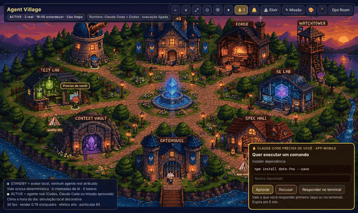
</p>
<p align="center"><sub>A real Claude Code permission request: the avatar runs to the Gatehouse, raises its hand and you approve on the card. Demo sessions. The interface is in Brazilian Portuguese.</sub></p>

---

You open Claude Code and Codex in several projects, launch subagents, leave tests running… and lose track of who is doing what, who is stuck waiting for you, and how much quota is left. **Agent Village** turns all of that into a village you can read at a glance, and it goes beyond watching: **it also coordinates the work**. You write a request in the village; it picks Claude Code or Codex by real remaining quota, checks that everything runs on your subscription (never on paid API), runs it with your approval and passes the result through a Release Gate.

Everything runs on your machine. The village reads the files Claude Code and Codex already write, never opens credentials and makes no external calls. The villagers' life (walks, chats, games) is computed locally, with no AI and no tokens.

## What it does

<table>
  <tr>
    <td width="50%">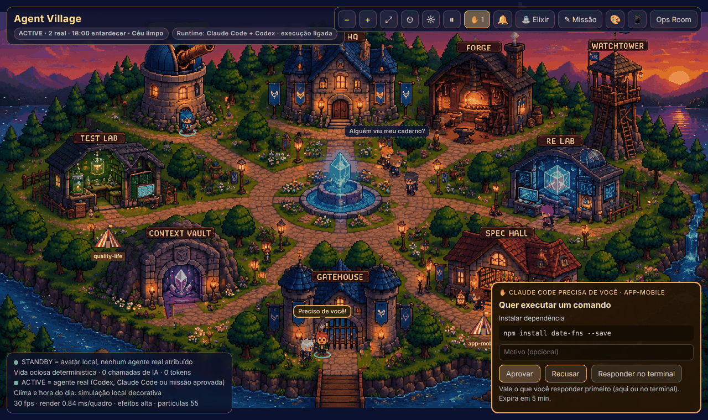</td>
    <td width="50%">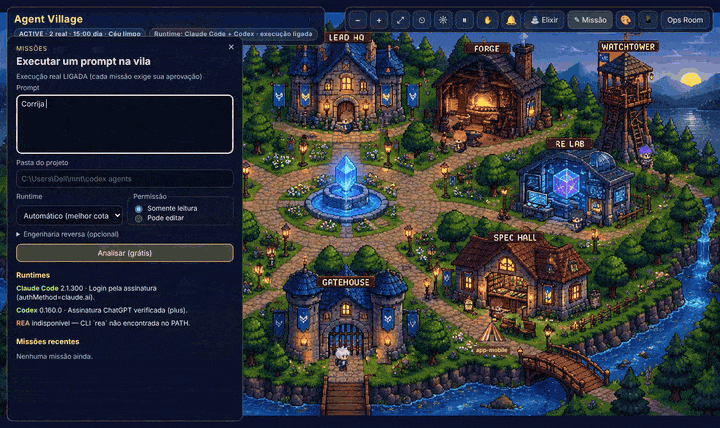</td>
  </tr>
  <tr>
    <td><b>Needs you.</b> When an agent asks for permission, that session's avatar runs to the Gatehouse and raises its hand. The card shows the command, file or page; approve, deny with a reason, or leave it to the terminal. First answer wins. Optional sound and browser notification.</td>
    <td><b>Missions from the village.</b> Write the request, pick the folder and whether the agent may edit. The analysis is free: level (S0 to S4), who will run it and why, the risk, and <b>"API spend allowed: US$ 0"</b>. Approve and watch the avatars; the Release Gate says whether it is done.</td>
  </tr>
  <tr>
    <td>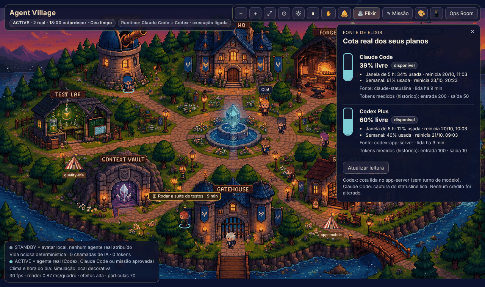</td>
    <td>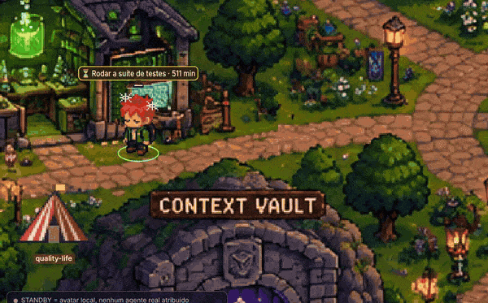</td>
  </tr>
  <tr>
    <td><b>Elixir Fountain.</b> The square's fountain is your plans' real quota: 5-hour and weekly windows for Claude Pro/Max and ChatGPT Plus, with the next reset, per account. Clicking only re-reads the data; it never invents credit and only refills when the provider confirms the reset.</td>
    <td><b>Waiting on tests.</b> While a real test or build runs, the avatar stays at its building with an hourglass and a timer: popcorn, then crossed arms (3 min), cobwebs (10 min), a nap (25 min). Confetti if it passed, a rain cloud if it failed.</td>
  </tr>
  <tr>
    <td>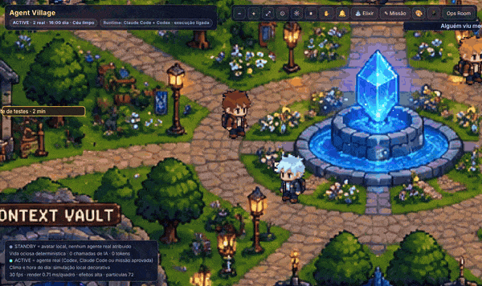</td>
    <td>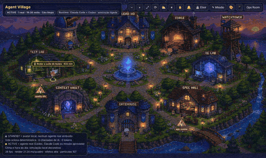</td>
  </tr>
  <tr>
    <td><b>Social life.</b> With no real work, villagers kick a ball around the square, play rock-paper-scissors for coins and go fishing on the bridge, each with its own personality. Real work interrupts any game at once, and coins never relate to tokens.</td>
    <td><b>A living scene.</b> Day and night by your local time, lamps and windows that light up, running water, a waterfall, smoke at the Forge, fireflies, rain and fog. 30 fps even on a 2013 laptop with integrated graphics.</td>
  </tr>
  <tr>
    <td>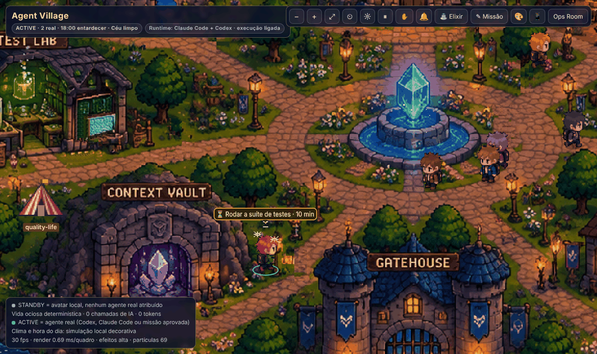</td>
    <td>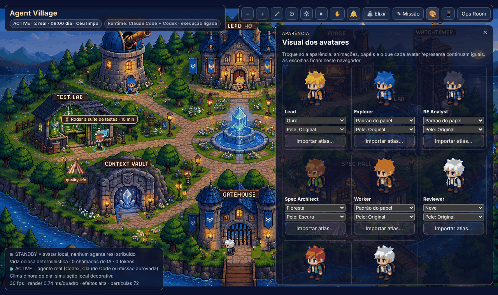</td>
  </tr>
  <tr>
    <td><b>A tent per project.</b> Every project with an open session gets a tent on a plot of the map. Its light is on while agents work, off when they stop, and it is folded away after the last session closes.</td>
    <td><b>Looks.</b> Change hair, outfit and skin tone, use another role's look, or import your own art following the <a href="ART-POLICY.md">art policy</a>. Animations stay the same.</td>
  </tr>
  <tr>
    <td>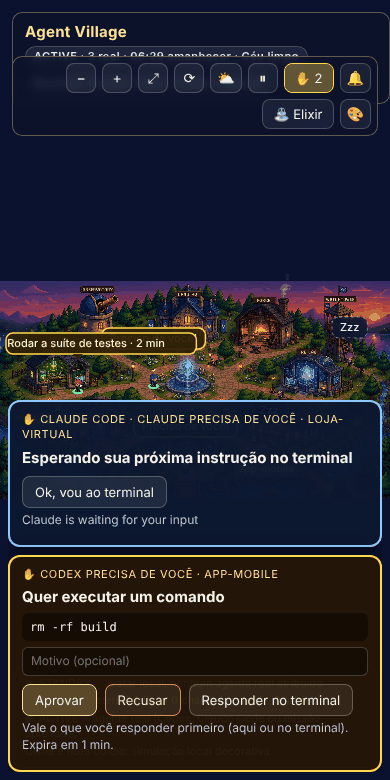</td>
    <td>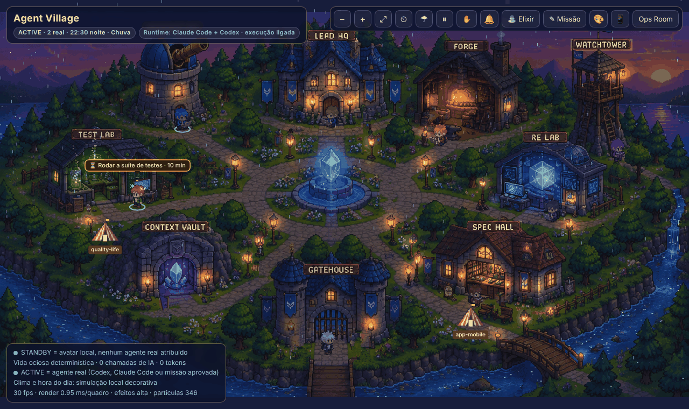</td>
  </tr>
  <tr>
    <td><b>On your phone.</b> On the same Wi-Fi, pair with an 8-character code and follow the village, approving or denying requests from anywhere in the house. The phone cannot create missions or see folder paths.</td>
    <td><b>Multiple accounts.</b> Every <code>~/.claude*</code> and <code>~/.codex*</code> folder becomes an account with its own quota. A mission goes to the account with the most quota left, or the one you pick.</td>
  </tr>
</table>

## Why Agent Village

| | |
|---|---|
| **Coordinates, not just watches** | Missions with a free analysis, automatic choice between Claude Code and Codex by real quota, explicit approval, a Release Gate and history in the Context Vault. |
| **US$ 0 API spend, enforced** | Runs only with a verified subscription login; API keys are stripped from agent processes; unknown billing is blocked. Exhausted quota waits for the reset or moves to another of your accounts. |
| **First-class Windows** | Native on Windows (exec-form hooks, no Git Bash needed), plus macOS, Linux, Docker and a desktop app. Tested on all three systems on every push. |
| **Lightweight** | Zero runtime dependencies, one Node process and Canvas 2D: 30 fps on a 4th-gen i5 with 6 GB RAM. |
| **Honest** | An avatar is ACTIVE only with a real agent. Weather, time of day and social life are local decoration and say so on screen. |

## Install

Requires [Node.js 20+](https://nodejs.org/) and Claude Code and/or Codex logged in with your plan.

```bash
git clone https://github.com/Marcusvrg23/agent-village.git
cd agent-village
npm run village
```

The village opens at http://127.0.0.1:4173/village/. Then, once (each command previews without `--yes` and backs up first):

```bash
npm run village:setup -- hooks install --yes        # raised hand (permission requests in the village)
npm run village:setup -- statusline install --yes   # Claude quota in the Elixir Fountain
```

To run real missions, start with `VILLAGE_CONTROL=1`. For the phone, `VILLAGE_LAN=1`. Docker: `docker compose up -d` (watch-only). Desktop app: `npm run package:desktop` on the target system.

Full documentation (in Portuguese): [README.md](README.md#documentação), [privacy and art policy](ART-POLICY.md), [validation report](VILLAGE-V22-VALIDATION.md).

## License

[MIT](LICENSE). Village art follows the [art policy](ART-POLICY.md).
